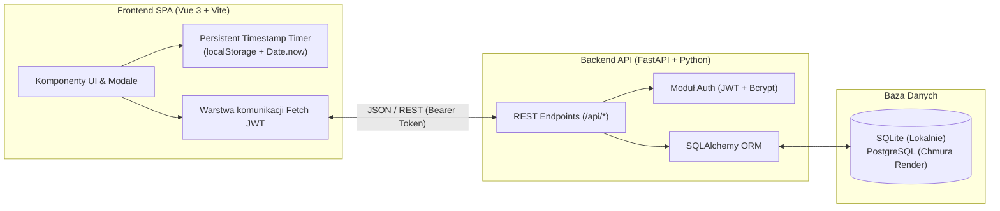

# TimeTracker Pro v2.0

Aplikacja webowa typu **Full-Stack** do precyzyjnej rejestracji i alokacji czasu pracy na skonfigurowane procesy biznesowe, ich etapy (subprocesy) oraz zadania robocze (**Work Tickets**).

Zbudowana w oparciu o **FastAPI + SQLAlchemy** (Backend REST API z autoryzacją JWT) oraz reaktywny interfejs **Vue 3 + Vite** (Frontend SPA).

---

## Kluczowe funkcjonalności

* **Trójpoziomowy model alokacji czasu (`Ticket` $\rightarrow$ `Proces` $\rightarrow$ `Subproces`)**:
  * Definiowanie słownika procesów biznesowych (np. *Pulpit Wewnętrzny*, *Produkcja*, *R&D*) wraz z ich etapami (*Spotkanie*, *Analiza*, *Development*, *Testowanie*, *Dokumentacja*).
  * Tworzenie zadań roboczych (**Work Tickets**) z unikalnym numerem `Ticket ID`, przypisaniem do procesu oraz zespołu wykonawców.
  * Izolowane oznaczanie ukończenia poszczególnych etapów (subprocesów) **w kontekście konkretnego zadania** (`TaskSubprocessCompletion`), bez wpływu na inne zadania korzystające z tego samego procesu.
* **Niezawodny, ciągły pomiar czasu (Persistent Timestamp Timer)**:
  * Dwa niezależne liczniki: **Total Time** (całkowity czas sesji pracy) oraz **Task Time** (czas bieżącego odcinka zadaniowego).
  * Oparcie zegarów na różnicy znaczników czasu (`Date.now()`) i zapisie w `localStorage` – licznik działa z dokładnością co do sekundy nawet po uśpieniu karty w tle przez przeglądarkę oraz po odświeżeniu strony (`F5`).
  * **Continuous Tracking**: Alokacja czasu jednym kliknięciem ikony zegara przy wybranym subprocesie natychmiast zapisuje wpis w bazie i zeruje licznik `Task Time`, podczas gdy `Total Time` płynie nieprzerwanie.
  * Możliwość **ręcznego dodania czasu** (`+`) w minutach i sekundach bez uruchamiania stopera.
* **Mój Grafik Dzienny (`Timetable`)**:
  * Karty podsumowania dnia (łączny czas, liczba alokacji, liczba aktywnych Ticketów).
  * Wizualne paski postępu pokazujące procentowy i godzinowy udział poszczególnych zadań w danym dniu.
  * Szczegółowa oś czasu wszystkich alokacji z możliwością filtrowania (własne wpisy vs. cały zespół) oraz usuwania omyłkowych wpisów.
* **Raportowanie i Eksport (`AllChargesReport`)**:
  * Interaktywna tabela podglądu wszystkich obciążeń czasowych na żywo z filtrowaniem po użytkowniku, procesie i frazie.
  * Eksport jednym kliknięciem do sformatowanej tabeli tekstowej **Retro `.TXT`** oraz arkusza **`.CSV`**.
* **Panel Konfiguracji (`Admin`) i Bezpieczeństwo (`JWT`)**:
  * Autoryzacja oparta o tokeny **JWT (Bearer)** oraz hashowanie haseł algorytmem **bcrypt**.
  * Pełny CRUD dla procesów, subprocesów, zadań oraz użytkowników (z dedykowanymi oknami modalnymi do przypisywania użytkowników i edycji danych).
  * Pełna responsywność (Desktop + urządzenia mobilne z wysuwanym menu bocznym).

---

## Architektura systemu



---

## Stack technologiczny

| Warstwa | Technologia |
| :--- | :--- |
| **Backend** | Python 3.11+, FastAPI, Uvicorn, Pydantic v2 |
| **Baza danych & ORM** | SQLAlchemy 2.0, SQLite (dev), PostgreSQL + `psycopg2-binary` (prod) |
| **Bezpieczeństwo** | OAuth2 Password Bearer, `python-jose` (JWT HS256), `passlib[bcrypt]` |
| **Frontend** | Vue 3 (Composition API), Vite 6, CSS3 Glassmorphism, FontAwesome 6 |
| **Testy automatyczne** | Pytest, FastAPI `TestClient`, `httpx` |

---

## Struktura projektu

```text
Time_tracking/
├── main.py                 # Punkt wejścia FastAPI, endpointy REST API, serwowanie SPA
├── models.py               # Modele relacyjne SQLAlchemy (User, Process, Subprocess, Task, TimeEntry, TaskSubprocessCompletion)
├── schemas.py              # Schematy walidacji i serializacji Pydantic v2
├── auth.py                 # Obsługa JWT, hashowania haseł bcrypt i zależność sesji DB
├── database.py             # Konfiguracja silnika SQLAlchemy (automatyczny przełącznik SQLite / PostgreSQL)
├── test_app.py             # Zestaw testów automatycznych (Pytest)
├── requirements.txt        # Zależności produkcyjne Pythona
└── frontend/               # Projekt reaktywnego frontendu (Vue 3 + Vite)
    ├── index.html
    ├── package.json
    ├── vite.config.js
    ├── src/
    │   ├── main.js
    │   ├── App.vue         # Główna aplikacja SPA (Widoki: Tasks, Timetable, Reporting, Admin)
    │   └── style.css       # Stylizacja Dark Glassmorphism & RWD
    └── dist/               # Zbudowana paczka produkcyjna serwowana przez FastAPI
```

---

## Uruchomienie lokalne

### 1. Wymagania wstępne
* **Python** 3.11+ (z `pip`)
* **Node.js** 18+ (opcjonalnie – wyłącznie do przebudowy frontendu w `frontend/`; gotowa paczka produkcyjna znajduje się już w `frontend/dist`)

### 2. Instalacja i start serwera (Tryb produkcyjny / standardowy)

```bash
# 1. Instalacja zależności Pythona
pip install -r requirements.txt

# 2. Uruchomienie serwera FastAPI (serwuje również zbudowany frontend Vue 3)
python main.py
```

Aplikacja będzie dostępna w przeglądarce pod adresem:
👉 **[http://127.0.0.1:8000](http://127.0.0.1:8000)**

*(Automatyczna dokumentacja Swagger UI API dostępna jest pod adresem: `http://127.0.0.1:8000/docs`)*

### 3. Tryb deweloperski Frontendu (Hot Module Replacement)

Jeśli chcesz modyfikować komponenty Vue z natychmiastowym odświeżaniem:

```bash
cd frontend
npm install
npm run dev
```

* Serwer deweloperski Vite wystartuje pod adresem `http://localhost:5173` (z automatycznym proxy zapytań `/api` do backendu FastAPI na porcie `8000`).
* Aby zbudować nową wersję produkcyjną do katalogu `frontend/dist/`:
  ```bash
  npm run build
  ```

---

## Testy automatyczne

Projekt posiada zestaw testów integracyjnych w pliku `test_app.py` (wykorzystujących izolowaną bazę danych SQLite `in-memory`), weryfikujących:
1. Serwowanie aplikacji frontendowej SPA (`GET /`).
2. Przepływ autoryzacji JWT (logowanie po nazwie użytkownika i adresie e-mail, odrzucanie błędnych poświadczeń).
3. Pełny CRUD użytkowników (wraz z blokadą usunięcia własnego aktywnego konta).
4. Pełny CRUD procesów i subprocesów (wraz z walidacją unikalności nazw).
5. Tworzenie i edycję zadań (**Work Tickets**) oraz **izolację statusu ukończenia subprocesów między różnymi zadaniami**.
6. Alokację czasu pracy, filtrowanie grafiku dziennego (`/api/time-entries`) oraz generowanie raportów `.TXT` i `.CSV`.
7. Przypisywanie/odpinanie użytkowników od zadań oraz bezpieczne kaskadowe usuwanie procesów.

Uruchomienie testów:
```bash
pip install pytest httpx
python -m pytest -v
```

---

## Wdrożenie produkcyjne (Render.com)

Aplikacja jest w pełni skonfigurowana pod wdrożenie chmurowe (np. **Render Web Service**):
* **Build Command**: `pip install -r requirements.txt`
* **Start Command**: `uvicorn main:app --host 0.0.0.0 --port $PORT`
* **Zmienne środowiskowe (Environment Variables)**:
  * `DATABASE_URL` – adres połączenia do bazy PostgreSQL (automatycznie konwertuje prefiks `postgres://` na `postgresql://`). W przypadku braku zmiennej używana jest lokalna baza SQLite.
  * `SECRET_KEY` – klucz prywatny do podpisywania tokenów JWT.
